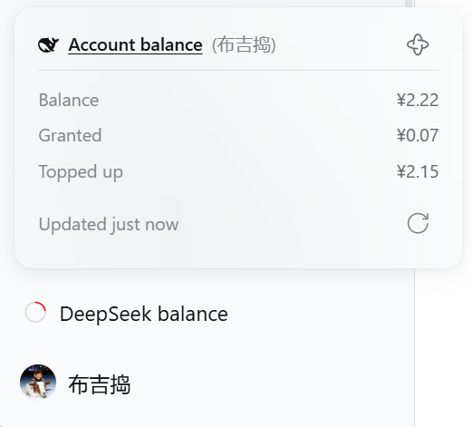
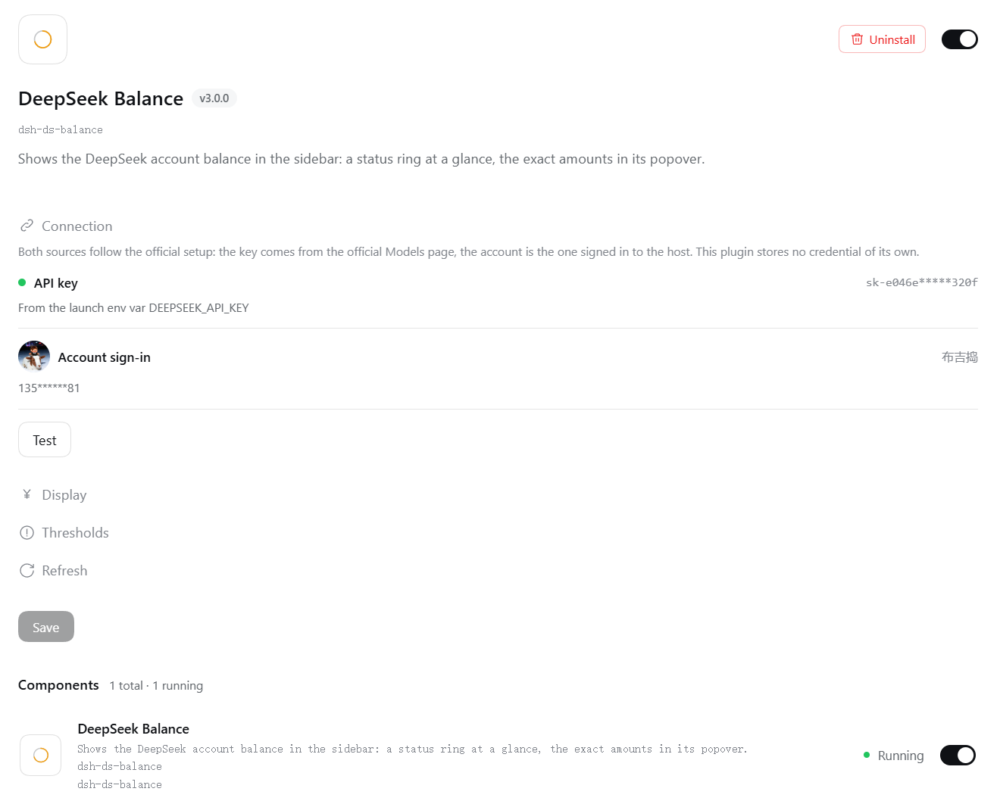

<p align="center">
  
</p>

<h1 align="center">dsh-ds-balance</h1>

<div align="center">
  <p><strong>DeepSeek account balance in the DSH sidebar</strong></p>
  <p><em>把 DeepSeek 账户余额放进 DSH 的左边栏</em></p>

  <p>
    <a href="https://api-docs.deepseek.com/"></a>
    <a href="https://github.com/deepseek-ai/deepseek-harness"></a>
  </p>

  <p>
    <a href="https://github.com/dsh-plugin-lab/dsh-ds-balance/actions/workflows/ci.yml"></a>
    <a href="https://www.npmjs.com/package/dsh-ds-balance"></a>
    <a href="LICENSE"></a>
    <a href="https://www.npmjs.com/package/dsh-ds-balance"></a>
  </p>

  <p>
    Per-version changes → <a href="https://github.com/dsh-plugin-lab/dsh-ds-balance/releases">Releases</a> (one-to-one with npm versions)
  </p>

  <p>
    <a href="README_zh.md">简体中文</a> · <strong><a href="README.md">English</a></strong>
  </p>
</div>

---

A status ring is pinned to the bottom of the sidebar; clicking it shows the actual balance figures. To change settings, open the **Plugins** page in the sidebar and pick this plugin.

## Data and credentials

The balance is read directly from the official DeepSeek API, not estimated from usage.

- The credential is resolved through DSH's credential channel; the plugin stores no key of its own: a key never lands in a settings file and is never returned to the UI.
- The configuration endpoint answers with only a fixed-length mask for the key, not even its last characters; a key is never logged and never written to any file of this plugin.
- Only `api.deepseek.com` is contacted; no other traffic is proxied or forwarded.
- Balance snapshots are stored per credential — **changing the key starts keeping records afresh**, so old figures are never mixed in.

## Getting started

**Prerequisites**: DSH on its current RC line (specify `@next` when installing); Node `>= 20`. The only source for the compatible range is `engines.dsh` in [package.json](package.json).

1. Install the host. Neither `latest` nor `alpha` is the line we declare, so specify the version line:

    ```bash
    npm install -g @deepseek-ai/dsh@next
    ```

2. Install the plugin:

    ```bash
    dsh plugin --profile web add dsh-ds-balance
    ```

3. Start (or restart) `dsh --profile web`; the balance entry appears at the bottom of the sidebar.

From source: `git clone`, then `npm install && npm run build`, then `dsh plugin --profile web add "$PWD"` — the same restart applies.
That `npm install` cannot be skipped: under a path install the repository supplies its own dependencies, and missing them makes the plugin show as "not running".

## What it shows

Three surfaces, each with one job:

| Surface | Where | What it does |
|---|---|---|
| Status ring | Pinned to the bottom of the sidebar | See at a glance how much is left and how close you are to the warning threshold |
| Balance popover | Click to expand | See the total, the granted / topped-up split, and how many minutes old the data is |
| Settings card | This plugin's details page under Plugins | Change the endpoint, the currency, the warning thresholds, the refresh cadence |

<p align="center">
  
  <br>
  <em>The entry is pinned to the bottom of the sidebar; clicking it opens the balance popover: the total, the granted / topped-up split, how many minutes ago the data was, and manual refresh at the bottom right.</em>
</p>

The ring itself is "what is going on right now", five states you can tell apart at a glance:

| The ring | Meaning | What you do |
|---|---|---|
| Coloured ring + an arc | There is a balance; the colour says more or less | Read the number |
| Grey ring + a rotating gap | Fetching, no result yet | Wait |
| Grey ring + a **+** in the middle | Not connected to your account yet | Configure it |
| Grey, empty ring | Connected to your account, which simply has no balance | Nothing |
| Red ring + a **cross** in the middle | No usable number here | Check it |

## What each thing is

| Thing | What it means |
|---|---|
| Arc length | The balance as a share of that currency's **warning threshold**, capped at a full circle |
| Colour | State only (normal / low / critical), never the amount; the **critical threshold only sets the colour** and takes no part in drawing the ring |
| The mark in the middle | **+** means not connected yet; go configure; **cross** means no usable number here — it could not be read, or it was read but the account cannot be used |
| Hover text | The **amount** when the number is trustworthy, that state's own line otherwise; collapsed and expanded say the same sentence |
| The source bracket | `(API key)` / `(account sign-in)` to the right of the popover title marks where this number came from; whichever is shown is the one refreshed |
| Data freshness | The "how long ago" in the popover, counted from the moment the data arrived |
| Manual refresh | Cooldown applies; the cooldown restarts when the refresh finishes, and the seconds on the popover are the real ones left |
| Credential badge | The label to the right of the key field, with only two wordings — "a key is configured." and "no key is configured." — the same as DSH's own plugin cards |
| Settings groups | Connection / Display / Thresholds / Refresh, all collapsed by default, expanded from their headers |

## Configuration

The card lives on the Plugins page: sidebar **Plugins** → "Installed" → click the **DeepSeek Balance** card to step into its details page.

<p align="center">
  
  <br>
  <em>The Plugins page: this plugin's card sits under "Installed"; click it to open the details page. The small ring at the bottom of the left-hand bar is the status ring.</em>
</p>

The configuration area is on the details page, right below the description, ready to edit. All four groups start collapsed:

- **Connection** — the API address and the credential. Both are blank by default: a blank address means the official endpoint; the credential inherits the one from the official model page and is read-only. The nested "Customized settings" holds only the credential reference name.
- **Display** — which currency amounts use, or let it follow the account.
- **Thresholds** — two lines per currency: a warning threshold and a critical threshold. Within one currency the **critical value must stay below the warning value**; saving is blocked otherwise.
- **Refresh** — the server refresh interval, the UI poll interval and the manual refresh cooldown; the defaults suit most setups.

Saving applies immediately; there is no need to restart DSH.

<p align="center">
  
  <br>
  <em>The configuration area on the details page, pictured with the four groups expanded; they start collapsed and expand from their headers. A group with an invalid entry expands itself.</em>
</p>

> **Upgrade note**: the keys these settings are filed under changed once with a host upgrade, and **old values are not migrated**; after upgrading, fill the four groups in again as above.

## Version compatibility

- **Which host version is required**: whatever `engines.dsh` in [package.json](package.json) declares — that range names the host **lines** this plugin covers, ceiling included; anything past the ceiling is not supported. If you need the settings UI, upgrade the host to the newest line: `npm install -g @deepseek-ai/dsh@next`.
- **The declaration enumerates lines explicitly**: only the lines listed in `engines.dsh` are promised. A new line past the ceiling becomes supported only after it has been measured in the [compat.yml](.github/workflows/compat.yml) matrix and written into the declaration; it does not follow the host automatically. **Patch releases inside a listed line (prereleases included) need no declaration change**.
- **Compatibility is measured**: weekly, [compat.yml](.github/workflows/compat.yml) runs the tests on the declared host line, plus a separate step checking the declared range still covers it; a red committed line opens a tracking issue. Verdicts and handling: [Compatibility](docs/PUBLISHING.md#兼容性).

## License

[MIT](LICENSE).

## Contributing

Bugs and requests go to the repository Issues.

Maintainer's document map → [AGENTS.md](AGENTS.md).
