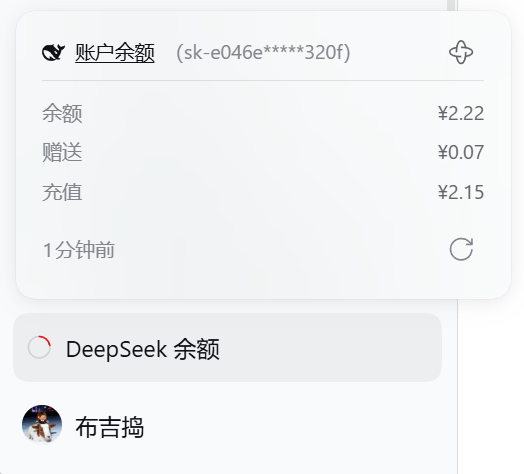
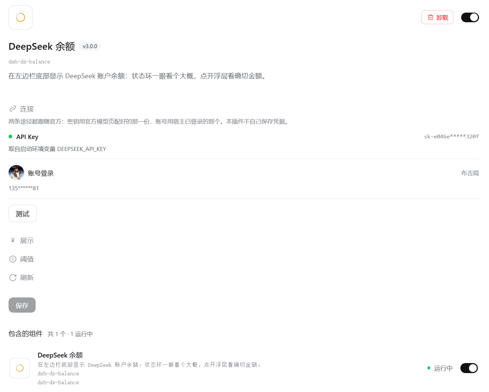

<p align="center">
  
</p>

<h1 align="center">dsh-ds-balance</h1>

<div align="center">
  <p><strong>把 DeepSeek 账户余额放进 DSH 的左边栏</strong></p>
  <p><em>DeepSeek account balance in the DSH sidebar</em></p>

  <p>
    <a href="https://api-docs.deepseek.com/"></a>
    <a href="https://github.com/deepseek-ai/deepseek-harness"></a>
  </p>

  <p>
    <a href="https://github.com/zlZayn/dsh-ds-balance/actions/workflows/ci.yml"></a>
    <a href="https://www.npmjs.com/package/dsh-ds-balance"></a>
    <a href="LICENSE"></a>
  </p>

  <p>
    <strong><a href="README.md">简体中文</a></strong> · <a href="README_en.md">English</a>
  </p>
</div>

---

左边栏底部常驻一个状态环，点开能看到具体的余额数字。要改配置，进侧栏的 **插件（Plugins）** 页，点开本插件。

## 数据与凭据

余额直接读 DeepSeek 官方接口，不是根据用量估算的。

- 凭据由 DSH 的凭据通道解析，插件不自己保存密钥：密钥不会写进设置文件，也不会返回给界面。
- 配置接口对密钥只回一个固定长度的掩码，连末几位也不给；密钥不落日志，不落本插件的任何文件。
- 只访问 `api.deepseek.com`，不代理、不转发其他流量。
- 余额快照按凭据分开存放 —— **换 key 会重新开始记账**，旧的数字不会混进来。

## 上手

**前置**：DSH 跟的是当前那条 RC 线（安装时写明 `@next`）；Node `>= 20`。兼容范围的唯一出处是 [package.json](package.json) 的 `engines.dsh`。

1. 装宿主。`latest` 与 `alpha` 都不是我们声明的那条线，请写明版本线：

    ```bash
    npm install -g @deepseek-ai/dsh@next
    ```

2. 装插件：

    ```bash
    dsh plugin --profile web add dsh-ds-balance
    ```

3. 启动（或重启）`dsh --profile web`，左边栏底部就会出现余额条目。

从源码安装：`git clone` 之后 `npm install && npm run build`，再执行 `dsh plugin --profile web add "$PWD"`，同样重启生效。
那一步 `npm install` 不能省 —— 按路径挂载时依赖由仓库自己提供，漏装会让插件显示「未运行」。

## 显示什么

三处界面，各管一件事：

| 界面 | 位置 | 做什么 |
|---|---|---|
| 状态环 | 左边栏底部，常驻 | 一眼看得出还剩多少、离预警线多远 |
| 余额浮层 | 点条目展开 | 看总额、赠送 / 充值拆分，以及数据是几分钟前的 |
| 设置卡片 | Plugins 页里本插件的详情页 | 换端点、换币种、调预警线、调刷新节奏 |

<p align="center">
  
  <br>
  <em>条目常驻左边栏底部，点开是余额浮层：总额、赠送 / 充值拆分、数据是几分钟前的，右下角是手动刷新。</em>
</p>

环本身就是「现在是什么情况」，一眼能分出五种：

| 环的样子 | 意思 | 你该做什么 |
|---|---|---|
| 彩环 + 一段弧 | 有余额，颜色表示多还是少 | 看数字 |
| 灰环 + 一段缺口在转 | 正在取，还没结果 | 等 |
| 灰环 + 中间一个 **＋** | 还没接入账户 | 去配置 |
| 灰色空环 | 已接入账户，本身没有余额 | 不用管 |
| 红环 + 中间一个 **叉** | 这里没有可用的数字 | 去查 |

## 每样东西是什么

| 东西 | 说明 |
|---|---|
| 弧长 | 余额占该币种**预警线**的比例，满格封顶一整圈 |
| 颜色 | 只表示状态（正常 / 偏低 / 告急），与金额大小无关；**告急线只决定颜色**，不参与画环 |
| 中心记号 | **＋** 是还没接入，去配置；**叉**是这里没有可用的数字 —— 读不到，或者读到了但账户不能用 |
| 悬停提示 | 数字可信时显示**金额**，其余情况显示这个状态自己的话；收起态与展开态说的是同一句 |
| 来源括号 | 浮层标题右侧的 `（API Key）` / `（账号登录）`，标的是这个数字的来路；显示哪条就刷哪条 |
| 数据新鲜度 | 浮层里的「多久之前」，从收到数据的时刻算起 |
| 手动刷新 | 带冷却，冷却从刷完那一刻重新计时，浮层上的秒数就是真实剩余 |
| 凭据徽标 | 密钥那一行右边的标签，只有「已配置密钥。」与「未配置密钥。」两种，与 DSH 自带的插件卡片一致 |
| 设置分组 | 连接 / 展示 / 阈值 / 刷新，默认全部收起，点组头展开 |

## 配置

卡片在 Plugins 页：侧边栏 **插件（Plugins）** →「已安装」→ 点 **DeepSeek 余额** 卡片进详情页。

<p align="center">
  
  <br>
  <em>插件页：本插件的卡片在「已安装」下，点卡片进详情页；左边那条栏底部的小环就是状态环。</em>
</p>

配置区在详情页，描述下面，直接可改。四组默认全收起：

- **连接** —— API 地址与凭据。两项默认留空：地址留空即用官方端点；凭据继承官方模型页那一份，只读不可改。二级「自定义设置」里只有凭据引用名。
- **展示** —— 金额用哪种币种，或让它跟随账户。
- **阈值** —— 每个币种两条线：预警线与告急线。同一币种内**告急值必须低于预警值**，保存时会拦下来。
- **刷新** —— 服务端刷新周期、界面轮询周期与手动刷新冷却；默认值适用于大多数情况。

保存即生效，不必重启 DSH。

<p align="center">
  
  <br>
  <em>详情页的配置区，截图中四组是展开的；默认全收起，点组头逐组展开。组里有填错的项时，那一组会自己展开。</em>
</p>

> **升级提示**：设置项的键名跟着宿主升级改过一次，**旧值不会自动迁移**；升级之后请按上面四组重填一次。

## 版本兼容

- **要哪一版宿主**：以 [package.json](package.json) 的 `engines.dsh` 为准，本插件跟的是宿主当前那条 **RC 线**。需要配置界面就把宿主升到那条线或更高：`npm install -g @deepseek-ai/dsh@next`。
- **声明是有意写窄的**：下限是我们实测过的那一版，只表示「不低于它」，不承诺以后都兼容 —— 宿主换一条补丁线再发版时，这个下限要跟着抬一次。
- **兼容性是实测出来的**：每周由 [compat.yml](.github/workflows/compat.yml) 在声明的那条宿主线上跑一遍测试，另有一步单独核对声明范围是否还罩得住；承诺线红了会开一条跟踪 issue。结论与处置见 [兼容性](docs/PUBLISHING.md#兼容性)。

## 许可

[MIT](LICENSE)。

## 贡献

报 bug 要带什么、提功能前先看什么、提 PR 前跑什么 → [CONTRIBUTING.md](CONTRIBUTING.md)。

维护者文档地图 → [AGENTS.md](AGENTS.md)。
